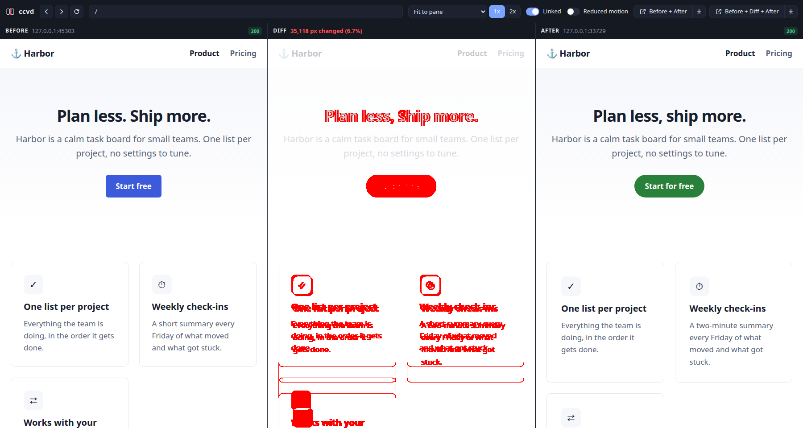
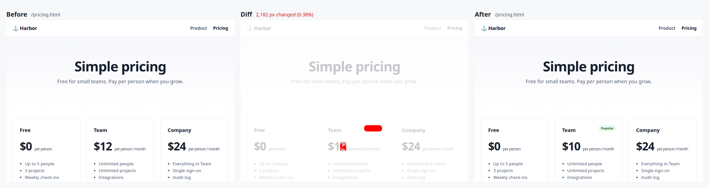

<div align="center">


# ccvd

**Claude Code Visual Diff**

Browse two versions of a site side by side, with an exact pixel diff between them.

[](https://www.npmjs.com/package/@laveez/ccvd)
[](https://github.com/laveez/ccvd/actions/workflows/ci.yml)
[](LICENSE)
[](https://nodejs.org)
[](#claude-code-plugin)

</div>

---

ccvd puts the before and after of a web change next to each other, with every changed pixel marked red in a pane between them. Scroll, click or type on one side and the other side does the same. When a view is worth keeping, one click saves it as an image. Claude Code runs the same engine without the window, to make before and after images for pull requests and to check its own UI work.



### Contents

- [Quick Start](#quick-start) · [Claude Code Plugin](#claude-code-plugin) · [Live View](#live-view) · [Images with ccvd shot](#images-with-ccvd-shot)
- [Options](#options) · [How It Works](#how-it-works) · [Security](#security) · [Limitations](#limitations) · [Contributing](#contributing)

---

## Quick Start

Try it on the bundled demo site:

```bash
npx @laveez/ccvd demo
```

Compare your own two versions, for example two local dev servers:

```bash
npx @laveez/ccvd http://localhost:8101 http://localhost:8102
```

ccvd opens the compare view in your browser. It needs Node.js 22.18 or newer and a Chromium-based browser: Google Chrome works, or install Playwright's Chromium with `npx playwright-core install chromium`.

To keep it installed, `npm install -g @laveez/ccvd`; the command is then `ccvd`, as in the examples below.

---

## Claude Code Plugin

Install the plugin, and Claude knows when and how to use ccvd:

```bash
claude plugin marketplace add laveez/ccvd
claude plugin install ccvd@ccvd
```

Then ask for what you want to see:

- "Show me main side by side with this branch."
- "Compare the site before today's merges with now, page by page."
- "Make before and after images of the pricing page at desktop and phone sizes for the PR."
- "Check that this CSS refactor changed nothing visible."

The skill has Claude check out both versions, start a server for each, run ccvd, look at every diff before reporting, and clean up afterwards.

---

## Live View

```bash
ccvd <before> <after>
```

| Part | What it does |
|---|---|
| **Before, Diff, After** | The two pages, and the diff between them: changed pixels red, the rest of the before page faded |
| **Linked** | Mirrors clicks, typing and links to both sides. Off, only the side you use gets the input |
| **Scrolling** | Always in sync: the side you scroll leads, the other follows to the same offset and is put back if it drifts |
| **Path field, back, forward, reload** | Navigate both sides together |
| **Size** | *Fit to pane*, or a preset from desktop 1920×1080 down to small phone 390×844, at 1x or 2x |
| **Diff** | Shows or hides the diff pane. Hidden, the two pages share the width and ccvd stops its regular captures of pages that keep animating. Your browser remembers the choice |
| **Reduced motion** | On by default: renders both sides with `prefers-reduced-motion: reduce`, so animated pages hold still. Turn it off to see the animations; ccvd suggests turning it back on when a page keeps animating |
| **Before + After, Before + Diff + After** | Open the current view as one image in a new tab, or download it |

The panes stream while pages move, and the diff pane marks its image as out of date. Once both sides are still, ccvd takes lossless captures, diffs them, and the diff pane shows the changed-pixel count.

---

## Images with ccvd shot

```bash
ccvd shot http://localhost:8101 http://localhost:8102 --path / --path pricing.html --size desktop --size phone
```

For every page and size, ccvd writes five PNGs to `ccvd-shots/`:

| File | Contents |
|---|---|
| `pricing-1920x1080-before.png` | The before page |
| `pricing-1920x1080-after.png` | The after page |
| `pricing-1920x1080-diff.png` | Changed pixels in red over the faded before page |
| `pricing-1920x1080-pair.png` | Before and after, labelled, side by side |
| `pricing-1920x1080-triple.png` | Before, diff and after, labelled |



Captures are full page by default, up to 16,384 px tall (`--viewport` for the visible part only), taken after the page has loaded, fonts are ready, lazy content has had a chance to load, and animations are frozen. `--json` prints each result with its changed and total pixels and both sides' HTTP status, so scripts and Claude can check the outcome.

---

## Options

```text
ccvd <before> <after> [options]        Open the live compare view
ccvd shot <before> <after> [options]   Save before, after and diff images
ccvd demo [options]                    Try the live view on a bundled demo site
```

`<before>` and `<after>` are http(s) addresses; `host:port` means `http://host:port`.

| Option | Applies to | Description |
|---|---|---|
| `--size <size>` | all | `fit` (live view default), a preset, or `WIDTHxHEIGHT`, with `@2` for 2x. Repeatable for `shot` (default `desktop`) |
| `--port <port>` | live, demo | Port for the view, default `2283` (ccvd on a phone keypad); the next free port if taken |
| `--no-open` | live, demo | Print the view's address instead of opening it |
| `--path <path>` | shot | Page to capture, resolved against each address like a link; repeatable. Without it, both addresses as given |
| `--viewport` | shot | Capture only the viewport |
| `--out <dir>` | shot | Folder for the images, default `ccvd-shots` |
| `--wait <ms>` | shot | Extra wait after the pages settle, default `300` |
| `--json` | shot | Print the results as JSON |
| `--browser <name>` | all | `chromium`, `chrome`, `msedge` or the path to a Chromium-based browser |
| `--no-reduced-motion` | all | Let pages animate. By default both sides render with `prefers-reduced-motion: reduce` |

Size presets: `desktop` 1920×1080, `laptop` 1440×900, `small` 1280×800, `tablet` 768×1024, `phone` 440×956, `phone-small` 390×844.

---

## How It Works

```mermaid
flowchart LR
    subgraph Browser["Your browser"]
        UI["Compare view"]
    end
    subgraph ccvd["ccvd (Node)"]
        Server["Local server<br/>127.0.0.1:2283"]
        Session["Session<br/>sync, settle, diff"]
    end
    subgraph Chromium["Headless Chromium"]
        Before["Before page"]
        After["After page"]
    end
    UI <-- "frames, input<br/>(WebSocket)" --> Server
    Server <--> Session
    Session <-- "screencast, captures,<br/>input (CDP)" --> Before
    Session <-- "screencast, captures,<br/>input (CDP)" --> After

    style UI fill:#38608c
    style Session fill:#2d4a2d
    style Before fill:#4a3d2d
    style After fill:#4a3d2d
```



- **One engine for both sides.** Both pages render in the same Chromium, each in its own browser context, at the same size and pixel ratio. Equal pages give equal pixels, so the diff has no noise to filter: any red is a real change.
- **Exact diff.** A pixel counts as changed when any of its RGBA bytes differ. Changed pixels are pure red, as in [roborazzi](https://github.com/takahirom/roborazzi); unchanged ones show the before page faded toward white. Where only one page has content, the area counts as changed.
- **Calibration.** [`test/baselines`](test/baselines/README.md) shows seven known changes, from one pixel to a layout shift, with the before, diff and after images ccvd makes of them. The tests check every one.
- **Live, then exact.** While pages move, the panes show Chromium's screencast. When both sides stop changing for 150 ms, and after a scroll once both report the same offset, ccvd captures both as PNG, decodes and diffs them in Node, and streams the exact images and the diff. A page that keeps animating is captured every 750 ms at first, backing off to every 4 s, and never while you scroll, click or type. Exact images replace the streamed ones only when no newer frame arrived during the capture, so the panes never jump back.
- **GPU and fresh frames.** The hidden browser draws on the GPU, several times cheaper than drawing in software for pages with blurs and animations. When the GPU cannot start, ccvd restarts the browser without it. The screencast has one frame on its way at a time and keeps only the newest one meanwhile, so the end of every scroll reaches the panes.
- **Input.** Mouse, wheel and keys from the view go to the pages as Chromium input events. The side you last touched sets the scroll offset: its window scroll moves the other side, which is put back if it drifts on its own. The hidden browser scrolls without smooth or threaded scrolling, so a page's reported offset matches what it draws. While linked, the touched side's clicks, keys and link navigations happen on both.

---

## Security

The view's server listens on `127.0.0.1` only, and the address ccvd prints carries a random token that the page controls and image exports require. Requests from other hosts or origins are refused, and the compared pages can only go to http(s) addresses. Chromium runs with its sandbox; where the sandbox cannot start, ccvd says so and runs without it. The compared pages cannot reach each other: they only report scroll positions, which ccvd checks are numbers from the top-level page. See [SECURITY.md](SECURITY.md) for details and how to report a vulnerability.

---

## Limitations

- **Chromium only.** Firefox and Safari rendering are not compared.
- **Linked clicks land at the same spot on both pages.** Where the layouts differ, the click on the other side can hit something else; unlink to use one side at a time.
- **Window scroll syncs; scroll areas inside a page do not.** The wheel scrolls them only on the side under the pointer.
- **A layout shift turns everything below it red**, because the diff is exact. Look for where the red starts.
- **Full-page captures stop at 16,384 px**, so endless feeds finish and images stay a sensible size.

---

## Contributing

Contributions are welcome. See [CONTRIBUTING.md](CONTRIBUTING.md) for setup, checks and the release process, and [AGENTS.md](AGENTS.md) if you work with a coding agent.

```bash
git clone https://github.com/laveez/ccvd.git
cd ccvd
npm ci
npm run build
node dist/bin/ccvd.js demo
```

## License

[MIT](LICENSE)
