# Calibration baselines

Before and after pages with a known diff, from one changed pixel to a layout shift. Each folder holds the two pages and the before, diff and after images ccvd made of them, and `test/e2e/baselines.test.ts` checks every case on each test run.

Shapes draw the same on every machine, so their cases have exact counts, and the tests also check that the same pixels are red as in the diff here. Text draws a little differently from machine to machine (fonts, GPU or CPU drawing), so the case where text changes is checked by where its red is.

| Case | Expected | Before | Diff | After |
|---|---|---|---|---|
| [Nothing changes](identical/) | exactly 0 changed pixels | 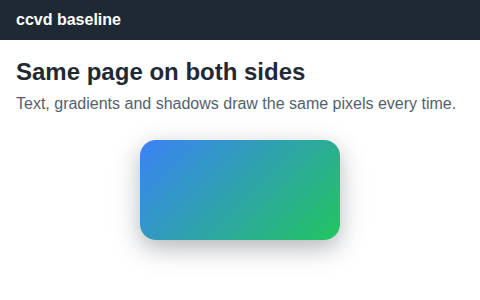 |  |  |
| [One pixel turns one shade bluer](one-pixel/) | exactly 1 changed pixel, all inside x 300, y 260 | 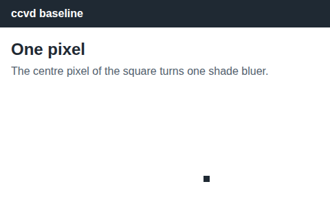 | 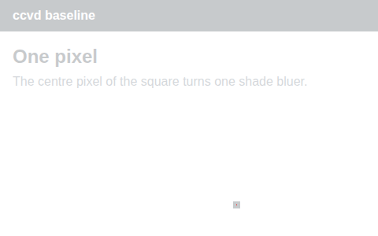 |  |
| [A 200×100 box changes colour](color-block/) | exactly 20,000 changed pixels, all inside x 140–339, y 140–239 | 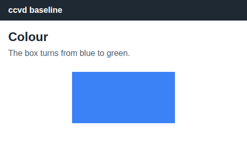 | 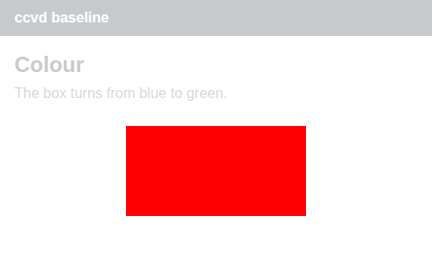 | 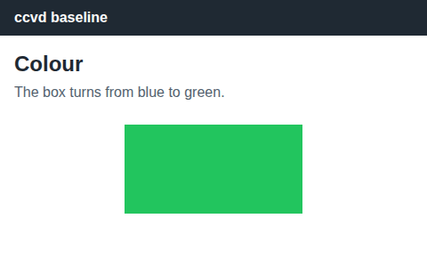 |
| [The box moves 10 px to the right](moved-block/) | exactly 2,000 changed pixels, all inside x 140–349, y 140–239 |  | 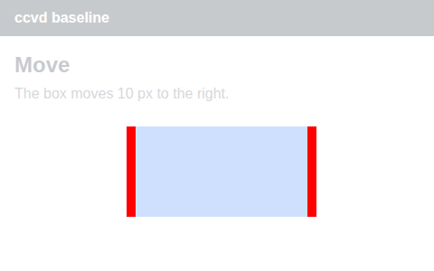 | 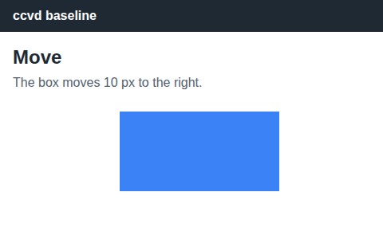 |
| [One word changes](text/) | some changed pixels, all inside x 90–249, y 56–87 | 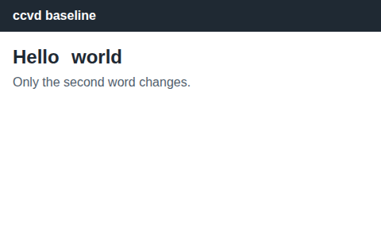 | 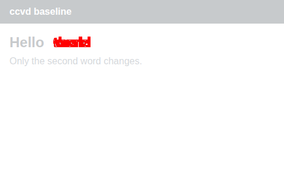 | 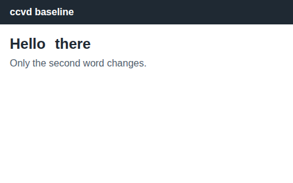 |
| [A banner pushes the content down](layout-shift/) | some changed pixels, on rows 40–339 | 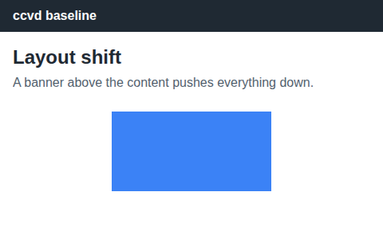 | 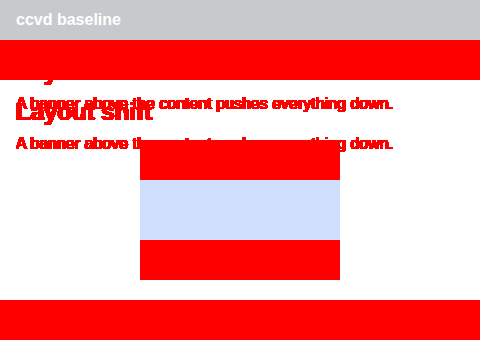 | 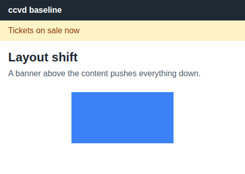 |
| [The after page is 60 px taller](taller/) | exactly 28,800 changed pixels, on rows 300–359 | 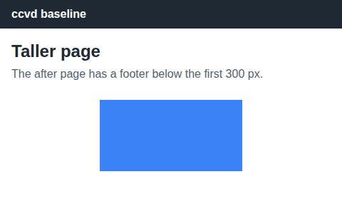 | 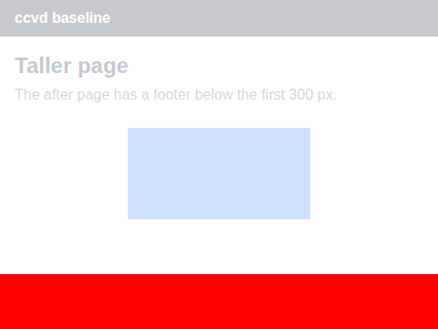 | 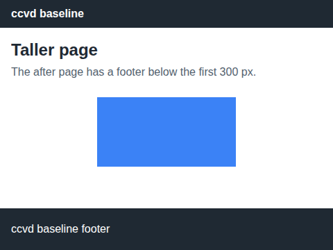 |

Drawn by `npm run baselines` at 480×300, full page, with Chromium 156.0.8078.47 on Linux. Run it again after a change to capturing or to the diff image, and look at every image before committing them.
